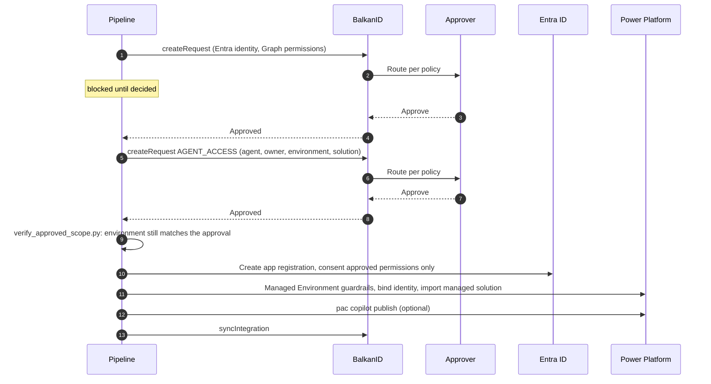

# Reference architecture: Microsoft Copilot Studio agent lifecycle

> This path has not been run end-to-end against a live Microsoft tenant; treat it as a reference design and validate in a test tenant first.

An approval-gated lifecycle for Copilot Studio agents delivered through a pipeline. It is
the design companion to the code in `terraform/copilot*`, `terraform/entra-agent-identity`
and `scripts/`. Audience: identity, platform and security architects. It assumes
familiarity with Entra ID and Power Platform, not with BalkanID.

## Problem statement

Microsoft provides preventive controls over Copilot agents, but they operate on
populations: environment security-group scoping, the Environment Maker role, DLP
policies, Managed Environment sharing limits. Each answers "may this group of makers
create agents here". The platform does not provide an approval step for a particular
agent: no supported way to require that a named person authorises this agent, with this
owner, in this environment, before it exists.

A Copilot Studio agent is a row in the Dataverse `bot` table plus `botcomponent` rows.
Any maker with an environment can create one in the portal in under a minute, with no
pipeline, ticket or review. Identity teams then learn about the agent after it exists and
is already reading corporate data.

This design adds a per-agent approval for agents delivered through a pipeline, without
replacing the tooling teams already use to author agents.

The honest boundary: a gate governs what passes through it. A maker who opens the
portal never meets it, so the coarse platform controls remain necessary alongside this
one, and the BalkanID Entra integration is how agents created outside the pipeline are
discovered.

## Design principles

1. Fail closed. A denial, a timeout, or an unreachable policy service all stop the
   pipeline. Nothing is created on an unresolved decision.
2. Govern the intent, not the toolchain. The approval is a policy decision about an agent
   and the identity it will run as, not a step bound to one CI system.
3. Do not fight the platform. Agents move between environments as solution components,
   so they are packaged that way rather than modelled in HCL.
4. The record must describe what was created. The approved scope is verified against the
   environment immediately before provisioning, so configuration cannot drift between
   decision and action.

## Flow

On a denial at either gate the pipeline exits non-zero and no later step runs. Two gates
are deliberate: the permissions an agent asks for are an identity decision, while whether
the agent should exist is a business one, and they often warrant different approvers. Run
the agent gate alone (`ENTRA_IDENTITY_GATE=false`) for a single approval.

## Components

| Component | Responsibility | Runs in |
|---|---|---|
| `scripts/entra_agent_identity_gate.py` | Submits a `CREATE_SERVICE_ACCOUNT` request for the Entra identity and its Graph permissions; blocks until decided | Pipeline |
| `scripts/gate.py` (`LIFECYCLE_TARGET=copilot`) | Submits an `AGENT_ACCESS` request for the agent; blocks until decided | Pipeline |
| `scripts/verify_approved_scope.py` | Compares the approved scope with the environment about to be provisioned; fails on drift | Pipeline |
| `terraform/entra-agent-identity` | Creates the Entra app registration, consents only the requested permissions | Terraform, `azuread` |
| `terraform/copilot-studio` | Managed Environment guardrails, identity binding, solution import | Terraform, `microsoft/power-platform` |
| `scripts/publish_copilot_agent.py` | Makes an imported agent live with `pac copilot publish` | Pipeline, `pac` CLI |
| `scripts/trigger_sync.py` | Asks BalkanID to re-read the integration so the new agent is discovered and linked to its owner | Pipeline |

Each component is single-purpose, so you can adopt a subset. The gates alone are useful
without any provisioning.

## Identities

Four identities appear here; conflating them collapses the segregation of duties the
gates create.

| Identity | Holds | Must not also be |
|---|---|---|
| Agent owner | Business accountability for the agent | The approver of their own request |
| Approver | Authority to grant the requested scope | The pipeline service principal |
| Pipeline service principal | Rights to create Entra objects and import solutions | The agent identity |
| Agent identity | Only the permissions that were approved | Reused across agents |

The pipeline service principal is the highest-value credential in the design: it can
create app registrations and consent Graph permissions. Prefer federated credentials to a
secret, and never reuse it as an agent's identity.

| Boundary | Authentication |
|---|---|
| Pipeline to BalkanID | Employee API key, or workload identity |
| Pipeline to Entra | Service principal, federated credential preferred |
| Pipeline to Power Platform | Service principal registered as a management app |

## Topologies

- **Gate only.** Call `scripts/gate.py` before whatever already creates agents. Needs no
  Microsoft credentials. Right when creation is already centralised in a pipeline and
  the gap is authorisation, not automation.
- **Gate and provision.** The full flow above.

Copilot Studio ALM is environment-based. Gating development defeats self-service
authoring; the control belongs on promotion into production, which maps onto the solution
export and import boundary the platform already imposes.

## Failure modes

| Failure | Behaviour |
|---|---|
| Approver denies | Exit 1, nothing created |
| Approver grants less than requested | Exit 1, nothing created |
| Approval window elapses | Exit 2, nothing created |
| BalkanID unreachable | Retries with backoff, then exit 3; never read as consent |
| Configuration changes between approval and provisioning | `verify_approved_scope.py` exits 1, nothing created |
| Identity created, agent gate later denied | Orphaned app registration; use remote state and the destroy path |
| Solution import fails after approval | Approval stands, no agent; re-run is idempotent at the solution level |
| Agent imported but not published | Agent exists but is not reachable; publish is a separate step by platform design |

## Platform constraints

Properties of Microsoft's platform as of September 2026.

| Constraint | Consequence |
|---|---|
| No Terraform resource creates a Copilot Studio agent | The agent ships in a solution package; Terraform imports it |
| `pac copilot pack` emits an unmanaged solution, with no offline conversion | Import and re-export as managed before the pipeline consumes it |
| An imported agent is not live until published | Publish is a distinct CLI step |
| Entra Agent ID has no Terraform support in `hashicorp/azuread` | Platform-issued identities are reconciled, not provisioned |
| Agents created from May 2026 receive an Entra Agent ID automatically | Review the intent, reconcile the object |
| Authentication settings, channels and icons do not survive import | Post-import configuration is required |

See [`AGENT_IDENTITY.md`](AGENT_IDENTITY.md) for the identity constraints in depth.

## Non-goals

- Runtime or invoke-time authorisation. This governs whether an agent may exist and what
  identity it holds, not what it does in a conversation.
- Data loss prevention on knowledge sources (Power Platform DLP and Purview cover that).
- Prompt and content safety.
- Agent-to-agent delegation and multi-agent orchestration.

## References

- [Export and import agents using solutions](https://learn.microsoft.com/en-us/microsoft-copilot-studio/authoring-export-import-bots)
- [Entra Agent ID](https://learn.microsoft.com/en-us/entra/agent-id/agent-identities)
- [Copilot Studio agent identities](https://learn.microsoft.com/en-us/microsoft-copilot-studio/govern-agents-identities-overview)
- [Power Platform Terraform provider](https://registry.terraform.io/providers/microsoft/power-platform/latest)
- [BalkanID documentation](https://docs.balkan.id/)
